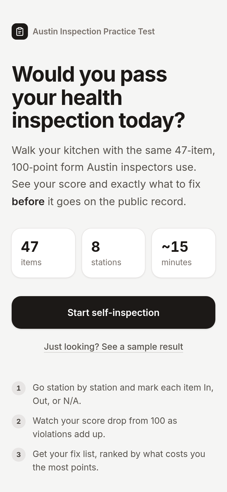
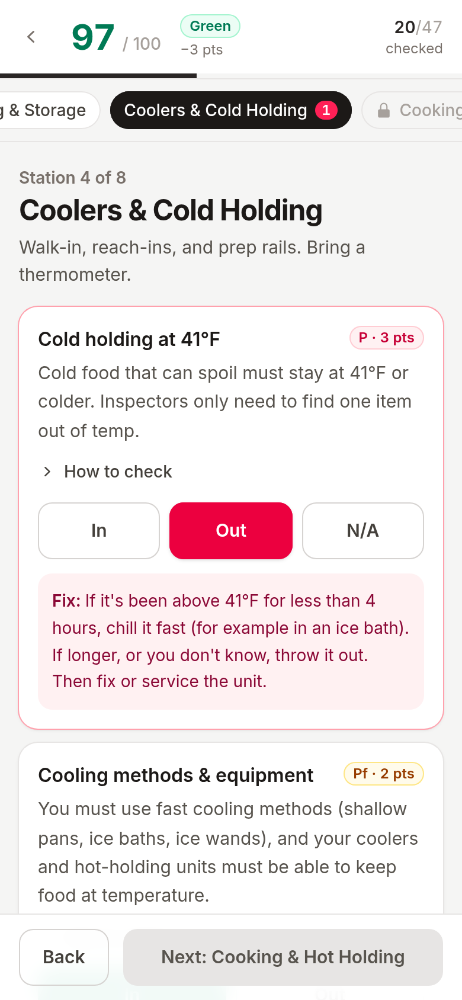
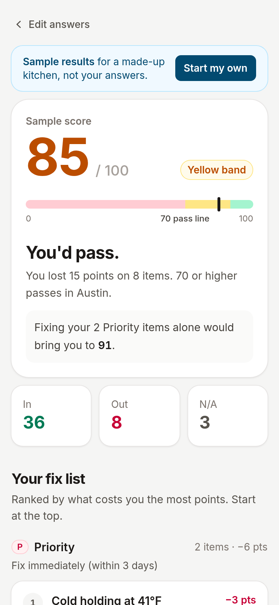

# Austin Inspection Practice Test

**Would you pass your health inspection today?** A mobile-first self-inspection tool for Austin restaurants.
Walk the kitchen with the same 47-item, 100-point form inspectors use, watch the score update as you go, and get a
fix list ranked by what costs you the most points, all before the real inspector arrives.

<p>
  
  
  
</p>

## Why

An independent restaurant has no cheap way to find out whether it would pass inspection until the inspector shows up.
By then, a low score is on the public record. The standard is public (the Texas Food Establishment Rules), but it runs to
hundreds of pages that nobody on the line has read. This turns it into a 15-minute practice test.

## What it does

- **Station-by-station walk-through.** 47 items grouped into 8 kitchen stations (paperwork, staff and handwashing, receiving
  and storage, coolers, cooking and hot holding, prep, dish and sanitizing, facilities). Each item is marked **In**, **Out**, or **N/A**, the same marks
  inspectors use, with a plain-English explanation and a "How to check" tip.
- **Live score.** Starts at 100 and drops by the item's official weight when something is marked Out: Priority 3 points,
  Priority Foundation 2, Core 1.
- **Fix as you go.** Marking an item Out immediately shows what to do about it.
- **Verdict and fix list.** Pass or fail against Austin's 70-point line, plus every problem ranked by points and grouped
  by the official correction deadline (3 days / 10 days / 90 days). Each item cites its form number and Food Code section.
- **Print or save as PDF** for the kitchen wall or the next staff meeting.
- **One-tap sample result** ("Just looking?") so anyone can see the full output in seconds.
- Works one-handed on a phone. Progress is saved in the browser. No account, no backend, no data leaves the device.

## Accuracy

The rubric is the product, so it is built from the official documents (copies in [`resources/sources/`](resources/sources/)):

- **Form:** Texas DSHS Retail Food Establishment Inspection Report, Form EH-06 (47-item, rev. 09-2015). It is the
  only official version that assigns points to every item, and its 3 / 2 / 1 weights add up to exactly 100.
- **Marking rules** (when In, Out, or N/A applies) come from the DSHS marking instructions.
- **Code references** for every item are checked against the "Applicable Code Sections" in the DSHS 56-item marking
  guide. `npm run validate:rubric` fails if any reference isn't found there, or if the points don't add up to 100.
- **Pass line:** 70 or higher passes; 69 or below fails and triggers a re-inspection (confirmed against local reporting
  on Austin Public Health inspections).
- **Green / Yellow / Red bands** are labeled *illustrative* in the app. Austin publishes a number, not an official
  color grade.

This is a practice tool, not legal advice, and it is not affiliated with the City of Austin, Austin Public Health, or
Texas DSHS.

## Tech

Vite · React 19 · TypeScript · Tailwind CSS v4 · Vitest · oxlint. A static single-page app with state in a `useReducer`,
saved to `localStorage`.

```
src/
  data/rubric.json        47 items: official text, points, code ref, plain language, how to check, fix
  data/sample.ts          the demo kitchen behind "See a sample result"
  lib/scoring.ts          pure scoring: score, pass/fail, band, ranked fix list
  lib/store.ts            app state and persistence
  screens/                Start, Inspect, Verdict
  components/             ScoreBar, ItemCard, Disclaimer
scripts/validate-rubric.mjs   checks the rubric against the source documents
```

## Run it locally

Requires Node 22+.

```bash
npm install
npm run dev               # http://localhost:5173
npm test                  # scoring and sample-data tests
npm run validate:rubric   # rubric integrity + code refs vs. the DSHS guide
npm run build             # type-check and production build to dist/
```
